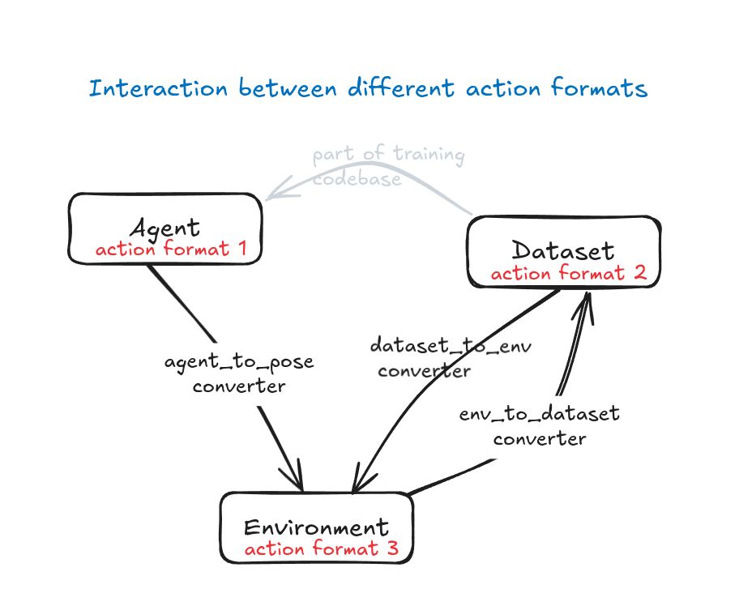

# robot-imitation-glue

Framework to reduce engineering efforts in using imitation learning for robot manipulation.

Facilitates:
- Dataset Collection (Lerobot dataset format) through **teleoperation** (Gello and Spacemouse supported but you can easily add others)
- Modifying/filtering **Lerobot Datasets**
- Replaying datasets on real hardware (for debugging)
- **Evaluating trained policies** on real hardware and save rollout observations(supports Lerobot ACT/ DP, OpenVLA, Pi0 and Pi-Fast but you can easily add others)

Everything is visualized using Rerun.

The code is written modularly so that you can easily:

1) integrate a new hardware setup
2) evaluate new learning algorithms
3) integrate new teleoperation methods

## Some core design decisions and assumptions

- code to describe and train networks for policy is not part of this codebase, recommended flow is to collect dataset here, train in separate codebase and then evalute the trained policy using a webserver (to avoid dependency issues and maintain separation of concerns).

- policies and teleop devices are both abstracted as agents.

- we assume a single robot arm + gripper. Control interface is absolute end-effector poses + absolute gripper width.

- we use the Lerobot dataset format and tooling to store demonstrations and rollouts.

- Callbacks are provided to switch between different action formats for the dataset/ policies:

## Documentation

- [Debugging best practices](docs/debugging.md): replaying episodes, running inference offline, hardware-free testing with the mock env, dataset utilities and the common pitfalls.

## Examples

2 examples are available of how to integrate this codebase for your robot.
Both are powered using our airo-mono repo, but you can freely select a control stack for your hardware.

### UR5station

### UR3station

## Development

### installation

We use [uv](https://docs.astral.sh/uv/) for dependency management.

- clone this repo with its submodules: `git clone --recurse-submodules git@github.com:airo-ugent/robot-imitation-glue.git`
  (already cloned? `git submodule update --init`)
- create the environment: `uv sync --all-extras`
- run anything in it with `uv run <cmd>`, e.g. `uv run pytest test/`

Everything that lives in a submodule, and everything that is heavy or hardware-only, is an
optional extra, so you can install only what you need instead of `--all-extras`:

| extra | contents |
| --- | --- |
| `airo` | vendored `airo-ipc` + `airo-mono` packages (typing, dataset-tools, spatial-algebra, camera-toolkit, robots) |
| `lerobot` | vendored `lerobot` fork: dataset recording/replay and the lerobot agents |
| `teleop` | vendored `airo-teleop` packages: teleop devices (Gello, SpaceMouse, phone) and their agents |
| `baseline` | `torch` / `torchvision`, for policies that run in-process |
| `hardware` | vendor SDKs of the UR3/UR5 stations (RealSense, Schunk, Dynamixel, SpaceMouse, UR IK) |
| `remote-policy` | client for policies served over HTTP (OpenVLA) |

A bare `uv sync` (no extras) needs no submodule checkout; that is what CI uses to run the tests.

